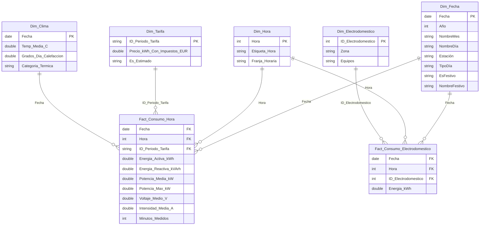

# Pipeline ETL – explicación completa

Este documento explica **qué hace el pipeline, por qué y cómo se comprueba que quedó bien**. Sirve de base
para la sección "Descripción del ETL" del informe y para la presentación.

---

## 1. ¿Qué es el pipeline? (y qué NO es)

En la clase de ETL (PRSS_3) el profesor lo define así: *un pipeline de datos es un conjunto de procesos
automatizados que extraen, transforman y cargan datos de diferentes fuentes hacia un destino final,
asegurando su calidad y disponibilidad para la toma de decisiones.*

- El **pipeline** es la "tubería": los scripts que llevan los datos desde internet hasta tablas limpias.
  En este proyecto son 3 comandos: `scrapy crawl fuentes` → `etl_energia.py` → `validar_calidad.py`.
- El **dashboard** (Power BI) **no** es el pipeline: es el destino donde se consumen los datos que el
  pipeline dejó listos. Si mañana cambian los datos, se vuelve a correr el pipeline y el dashboard se
  actualiza sin rehacer nada a mano.

```
                     EXTRACT                     TRANSFORM                         LOAD
 ┌──────────────┐   (Scrapy)   ┌──────────────┐  (PySpark)   ┌─────────────────┐       ┌──────────┐
 │ UCI (energía)│──┐           │              │  reglas de   │  datos_limpios/ │       │          │
 │ Meteostat    │──┤──────────▶│ datos_sucios │─────────────▶│  modelo estrella│──────▶│ Power BI │
 │ gouv.fr      │──┤  tal cual │   (crudo)    │   calidad    │  CSV + Parquet  │       │  + DAX   │
 │ Eurostat     │──┘           └──────────────┘      │       └─────────────────┘       └──────────┘
 └──────────────┘                                    ▼                │
                                              rechazados/             ▼
                                         (cuarentena + motivo)  validar_calidad.py
                                                                (38 pruebas: PASA/FALLA)
```

Esto sigue la idea de **capas** que se usa en la industria (arquitectura "medallón" de Databricks):

| Capa | Carpeta | Regla |
|---|---|---|
| Bronce (crudo) | `datos_sucios/` | Se guarda **exactamente** lo que entregó la fuente. Nunca se edita. |
| Plata (limpio) | lo hace Spark en memoria | Datos validados, sin duplicados, con tipos correctos. |
| Oro (negocio) | `datos_limpios/` | Modelo estrella listo para análisis. |
| Cuarentena | `rechazados/` | Lo que no pasó las reglas, **con el motivo**. No se pierde nada en silencio. |

---

## 2. EXTRACT – Scrapy (`extraccion/`)

Se usa Scrapy, como en el taller de la materia, pero en vez de raspar HTML se descargan **archivos y APIs**:

| Fuente | Petición | Detalle |
|---|---|---|
| Energía | 1 descarga del `.zip` de UCI | El pipeline de Scrapy lo descomprime. Si UCI no responde, usa un espejo idéntico (respaldo). |
| Clima | 1 descarga del `.csv.gz` de Meteostat | Spark lee `.gz` directamente, no hace falta descomprimir. |
| Festivos | 5 peticiones a la API (2006…2010) | Un JSON por año. |
| Tarifas | 1 consulta a la API SDMX de Eurostat | Filtrada a Francia, hogares, banda 2.500-4.999 kWh/año. |

**Buenas prácticas aplicadas en la extracción:**
- `ROBOTSTXT_OBEY = True`: se respeta el robots.txt de cada sitio. Por eso **no** se usó Open-Meteo:
  su robots.txt prohíbe bots (`Disallow: /`).
- `DOWNLOAD_DELAY = 1` y una petición a la vez por sitio, para no saturar los servidores.
- **Manifiesto** (`datos_sucios/_manifiesto_extraccion.json`): por cada archivo guarda la URL real usada,
  la fecha de descarga, el tamaño y la huella **SHA-256**. Si la fuente cambia, la huella cambia: así se
  sabe con qué versión exacta de los datos se hizo el análisis (trazabilidad).
- Reintentos (`RETRY_TIMES = 3`) y fuente de respaldo para el archivo principal.

---

## 3. TRANSFORM – PySpark (`etl/etl_energia.py`)

### 3.1 Política de calidad (acordada con el profesor)

1. Lo inválido (nulos, negativos, imposibles, duplicados) **se elimina**. **No se imputa** con media,
   mediana ni moda.
2. Nada se elimina en silencio: cada fila sale a `rechazados/` con la columna `Motivo`, y
   `reporte_calidad.md` dice cuántas filas afectó cada regla.
3. **Valor atípico ≠ error.** Los rangos son **físicos** (lo que es imposible para una casa), no
   estadísticos. Un pico real de 11 kW se conserva, porque es justamente un "evento inusual" que pide
   el requerimiento 4. Si se borraran los atípicos, se borraría la respuesta a esa pregunta.
4. Todo se lee como **texto** (sin `inferSchema`) y cada conversión de tipo se hace explícita con
   `try_cast` / `try_to_timestamp`. Si un valor no convierte, queda NULL y una regla lo atrapa.
5. Los datos tienen un **contrato**: si el archivo no trae las columnas esperadas, el ETL se detiene en
   vez de producir resultados equivocados.

### 3.2 Energía (UCI) – minuto a minuto

| Paso | Qué se hace | Resultado real |
|---|---|---:|
| Lectura | `;` como separador, todo como texto, contrato de 9 columnas | 2.075.259 filas |
| Normalización de texto | `trim` + `'?'`, `''`, `NA`… → NULL | 155.874 celdas `?` |
| R01 Validez | `Date` + `Time` (`d/M/yyyy H:mm:ss`) → timestamp | 0 |
| R02 Completitud | alguna medida nula → eliminar (es la misma fila completa sin medición) | **25.979** |
| R03 Validez | texto no numérico | 0 |
| R04 Validez | **negativos** en potencia, voltaje, intensidad o submedidores | 0 |
| R05 Validez | voltaje fuera de 200-260 V (red de 230 V) | 0 |
| R06 Validez | intensidad > 60 A o potencia > 15 kW | 0 |
| R07 Consistencia | submedidores (Wh) > energía total del minuto + 1 Wh → imposible | **33** |
| R08 Consistencia | potencia activa > voltaje × intensidad (P ≤ S) | 0 |
| R09 Unicidad | minuto repetido (se deja el primero) | 0 |
| **Normalización de unidades** | todo a **kWh** (la unidad que se factura) | — |
| Agregación | minuto → **hora** (sumas de energía, promedios de voltaje/intensidad, máximo de potencia) | 34.168 horas |
| R10 Completitud | hora con < 45 de 60 minutos medidos → no comparable | 17 |
| R11 Consistencia | resto de la vivienda negativo en la hora | 0 |

**Normalización de unidades** (fórmulas de la documentación de UCI):

| Columna original | Unidad original | Columna limpia | Conversión |
|---|---|---|---|
| Global_active_power | kW (promedio del minuto) | Energia_Activa_kWh | ÷ 60 |
| Global_reactive_power | kVAr | Energia_Reactiva_kVArh | ÷ 60 |
| Sub_metering_1 (cocina) | Wh | Cocina_kWh | ÷ 1000 |
| Sub_metering_2 (lavandería) | Wh | Lavanderia_kWh | ÷ 1000 |
| Sub_metering_3 (calentador + A/C) | Wh | Calentador_AC_kWh | ÷ 1000 |
| — | — | Otros_kWh (resto de la casa) | total − los 3 submedidores |

> **¿Por qué el "resto de la casa" se calcula por hora y no por minuto?** Los submedidores vienen
> redondeados a Wh enteros. En un minuto suelto su suma puede pasarse del total por el redondeo y daría
> un resto negativo. Sumados en la hora, esos redondeos se compensan y el resto siempre es ≥ 0
> (mínimo real: 0,028 kWh), sin tener que recortar ni inventar nada. La validación detectó este caso
> en una versión anterior y por eso se corrigió.

**¿Por qué pasar de minutos a horas?** (1) La pregunta de negocio es por hora, día, mes y año, y nadie
pregunta por minutos. (2) El clima viene por hora. (3) Power BI trabaja mucho más rápido con 34 mil filas
que con 2 millones. La energía no se pierde: la validación comprueba que la suma de las horas es igual
a la suma de los minutos válidos de esas horas.

### 3.3 Clima (Meteostat) – por hora

| Paso | Qué se hace | Resultado real |
|---|---|---:|
| Lectura | archivo sin encabezado → se nombran las 13 columnas | 223.787 filas (desde 1983) |
| C01 Validez | fecha + hora → timestamp | 0 |
| **Zona horaria** | UTC → **UTC+1 fijo** (la escala del medidor, ver §6) | — |
| Alcance | solo el periodo del medidor (16/12/2006 a 26/11/2010) | 33.734 filas |
| **Completitud por columna** | variable con > 20 % de nulos se descarta **entera** | `prcp` (38 %), `snow`, `wpgt`, `tsun`, `coco` (100 %) |
| C02 Completitud | nulo en temperatura, humedad, viento o presión | 49 |
| C04 Validez | rangos físicos (−30..45 °C, 0..100 %, 0..150 km/h, 900..1100 hPa) | 0 |
| C05 Unicidad | fecha-hora repetida | 0 |
| Agregación | hora → **día** (media, mínima, máxima) | — |
| C06 Completitud | día con < 18 de 24 observaciones | 44 días |
| Enriquecimiento | grados-día de calefacción/refrigeración (definición Eurostat) y categoría térmica | 1.396 días |

> Descartar una columna incompleta en lugar de imputarla también es una regla de calidad: rellenar el
> 38 % de la lluvia con un promedio sería inventar datos.

### 3.4 Festivos (API gouv.fr)

Cada archivo es `{"2007-05-01": "1er mai", ...}`, con las **fechas como nombres de campo**. Se lee como
texto, se convierte a un mapa (`from_json`) y se **explota** en filas (fecha, nombre). Reglas: fecha
convertible (F01), nombre no vacío (F02), dentro de 2006-2010 (F03), sin fechas repetidas (F04).
Se normalizan los nombres al español con un diccionario (*Jour de Noël* → *Navidad*).

### 3.5 Tarifas (Eurostat)

Se valida unidad/moneda/país (T01), formato del periodo `AAAA-S1/S2` (T02), precio no nulo (T03) y en
rango (0, 1) EUR/kWh (T04), sin repetidos (T05). Luego un **pivot** convierte las filas por tipo de impuesto
en columnas: `Precio_kWh_Sin_Impuestos_EUR`, `Precio_kWh_Sin_IVA_EUR`, `Precio_kWh_Con_Impuestos_EUR`.

---

## 4. ¿Cómo se unen 4 datasets diferentes? → modelo estrella con PK y FK

Las cuatro fuentes **no se pegan en una sola tabla gigante**, porque cada una tiene una granularidad
distinta: la energía va por hora, el clima por día, los festivos son una lista de fechas y las tarifas
son semestrales. Si se juntaran todas en una tabla se repetirían datos y se descuadrarían las sumas.

Lo que se hace es buscar una **llave común** y construir un **modelo estrella**:
- En el centro van las **tablas de hechos** (`Fact_`): las mediciones numéricas que se suman.
- Alrededor van las **dimensiones** (`Dim_`): las descripciones por las que se filtra y agrupa.
- Cada dimensión tiene una **PK** (llave primaria, única). Cada hecho tiene **FK** (llaves foráneas) que
  apuntan a esas PK.

| Fuente original | Termina en | Llave que la conecta |
|---|---|---|
| UCI energía | `Fact_Consumo_Hora` y `Fact_Consumo_Electrodomestico` | `Fecha` + `Hora` |
| Festivos | columnas `EsFestivo`, `NombreFestivo`, `TipoDía` dentro de `Dim_Fecha` | `Fecha` |
| Clima | `Dim_Clima` | `Fecha` |
| Tarifas | `Dim_Tarifa` | `ID_Periodo_Tarifa` (ej. `2008-S1`) |
| (generadas por el ETL) | `Dim_Fecha`, `Dim_Hora`, `Dim_Electrodomestico` | `Fecha`, `Hora`, `ID_Electrodomestico` |



**¿Por qué dos tablas de hechos?** `Fact_Consumo_Hora` tiene una fila por hora con el total y las medidas
eléctricas. `Fact_Consumo_Electrodomestico` tiene la misma energía **desglosada en 4 zonas**, en formato
largo (una fila por hora y zona, hecho con `unpivot`). Así el gráfico de "proporción por electrodoméstico"
es un simple gráfico de anillo, sin fórmulas raras. La validación comprueba que cocina + lavandería +
calentador + resto = total en **cada una** de las 34.151 horas.

### Relaciones para crear en Power BI (vista Modelo)

| Desde (muchos, *) | Hacia (uno, 1) | Cardinalidad | Dirección del filtro |
|---|---|---|---|
| Fact_Consumo_Hora[Fecha] | Dim_Fecha[Fecha] | * : 1 | Única |
| Fact_Consumo_Hora[Hora] | Dim_Hora[Hora] | * : 1 | Única |
| Fact_Consumo_Hora[ID_Periodo_Tarifa] | Dim_Tarifa[ID_Periodo_Tarifa] | * : 1 | Única |
| Fact_Consumo_Hora[Fecha] | Dim_Clima[Fecha] | * : 1 | Única |
| Fact_Consumo_Electrodomestico[Fecha] | Dim_Fecha[Fecha] | * : 1 | Única |
| Fact_Consumo_Electrodomestico[Hora] | Dim_Hora[Hora] | * : 1 | Única |
| Fact_Consumo_Electrodomestico[ID_Electrodomestico] | Dim_Electrodomestico[ID_Electrodomestico] | * : 1 | Única |

> Dim_Clima **no** se relaciona con Dim_Fecha (eso crearía dos caminos para el mismo filtro y Power BI
> marcaría ambigüedad). Cada dimensión cuelga directamente de los hechos: es una estrella pura.

---

## 5. LOAD (`datos_limpios/`)

Cada tabla se guarda en **CSV** (UTF-8) y en **Parquet** (`datos_limpios/parquet/`).
- **Para Power BI se recomienda Parquet**: guarda los tipos (fecha, entero, decimal). Con CSV, si Windows
  está en español, Power BI puede leer `3.6322` como texto o como 36322 por el separador decimal.
- Spark escribe con pandas (`toPandas()`), porque en Windows el `write.csv()` de Spark necesita
  `winutils.exe`/Hadoop.
- La carga es **idempotente**: cada ejecución borra y regenera `datos_limpios/` y `rechazados/`, así que
  correrlo dos veces da exactamente el mismo resultado (no se duplican filas).

---

## 6. Decisiones y supuestos (para defender en la presentación)

1. **El medidor no cambia de hora en verano.** El 25/03/2007 registra las 02:00, una hora que en París no
   existió (ese día se saltó de 02:00 a 03:00). El medidor siempre anota en **UTC+1 fijo**. Por eso el
   clima (UTC) se convierte a UTC+1 y no a la hora de París. Consecuencia para el análisis: en verano las
   horas pico aparecen una hora "antes" que en el reloj de pared.
2. **Tarifas 2006-S2 y 2007-S1:** Eurostat no publica esos dos semestres para Francia (cambió la
   metodología en 2007). Se usa el precio publicado más cercano (2007-S2), marcado `Es_Estimado = Sí`.
   Es un supuesto de negocio para estimar el costo de 6 meses y medio, no una imputación de mediciones.
3. **Clima de París-Montsouris** (~7 km de Sceaux): es la estación oficial más cercana con datos horarios
   2006-2010. Las dos están en la misma zona urbana y el clima es prácticamente igual.
4. **Festivos 2008:** el 1 de mayo coincidió con la Ascensión. La API devuelve un solo nombre por fecha
   (*Ascension*), por eso 2008 tiene 10 festivos y no 11. El día sigue marcado como festivo.
5. **Umbral de 45 minutos por hora:** una hora con 10 minutos medidos tendría una energía artificialmente
   baja. Solo 17 horas de 34.168 quedaron por debajo.
6. **Estaciones meteorológicas:** invierno = dic-ene-feb, primavera = mar-abr-may, verano = jun-jul-ago,
   otoño = sep-oct-nov.
7. **Grados-día (Eurostat):** calefacción = 18 − T_media si T_media ≤ 15 °C; refrigeración =
   T_media − 21 si T_media ≥ 24 °C. Permiten relacionar el consumo con la necesidad de calentar o enfriar.

---

## 7. ¿Cómo sabemos que la transformación quedó bien? (`etl/validar_calidad.py`)

La validación es **independiente** del ETL: está hecha con pandas, no con Spark, para no "corregirse la
tarea a sí mismo". Se agrupa en las **6 dimensiones de calidad de datos** que usa la industria:

| Dimensión | Pregunta | Pruebas |
|---|---|---|
| **Completitud** | ¿Falta algo? | Ninguna tabla tiene nulos. **Balance:** leídas = válidas + rechazadas (2.075.259 = 2.049.247 + 26.012). Toda fila rechazada tiene motivo. Clima disponible para ≥ 90 % de las horas (96,8 %). |
| **Validez** | ¿Cumple formatos y rangos? | Sin negativos. Voltaje 200-260 V. 45-60 minutos por hora. Energía de la hora ≤ potencia máxima. T_mín ≤ T_media ≤ T_máx. Humedad 0-100 %. Precios coherentes. |
| **Unicidad** | ¿Hay repetidos? | Las 7 llaves primarias son únicas (incluidas las compuestas `Fecha + Hora`). |
| **Integridad referencial** | ¿Toda FK tiene su PK? | Las 7 relaciones del modelo, con 0 filas huérfanas. Si fallara, Power BI mostraría "(En blanco)" en los gráficos. |
| **Consistencia** | ¿Los datos se contradicen? | Suma de las 4 zonas = total, en cada hora. Calendario continuo. 10-11 festivos por año. TipoDía coherente. |
| **Exactitud (conciliación)** | ¿Los números son los reales? | Energía cargada = energía calculada por el ETL. **Recálculo desde el archivo crudo** de 4 días (96 horas) con pandas: diferencia 0,000000 kWh. |

Resultado actual: **38/38 pruebas pasan** (`datos_limpios/reporte_validacion.md`). El script termina con
código de salida 1 si alguna falla, así funciona como **compuerta de calidad**: si no pasa, no se carga a
Power BI.

---

## 8. Checklist de buenas prácticas de ETL aplicadas

- [x] Datos crudos inmutables y separados de los limpios (capas bronce / plata / oro).
- [x] Trazabilidad de la extracción: URL, fecha, tamaño y SHA-256 de cada archivo.
- [x] Contrato de esquema: el ETL se detiene si cambian las columnas de una fuente.
- [x] Tipos explícitos (`try_cast`), nunca `inferSchema` sobre datos sucios.
- [x] Normalización de texto (`trim`, marcas de nulo, nombres) **antes** de validar y deduplicar.
- [x] Normalización de unidades (todo a kWh) y de zona horaria (todo a la escala del medidor).
- [x] Reglas de calidad numeradas, una por línea, cada una con su dimensión de calidad.
- [x] Cuarentena con motivo en vez de borrar en silencio.
- [x] Rangos físicos, no estadísticos: no se borran los atípicos reales.
- [x] Sin imputación con media, mediana o moda; las columnas muy incompletas se descartan.
- [x] Conteos antes y después de cada regla (`reporte_calidad.md`).
- [x] Conciliación origen-destino (conteos y sumas) y recálculo independiente desde el crudo.
- [x] Integridad referencial PK-FK comprobada antes de cargar a Power BI.
- [x] Carga idempotente (re-ejecutable sin duplicar).

### Referencias consultadas
- Kimball, R. *The Data Warehouse ETL Toolkit* (bibliografía de la materia): modelo estrella y procesos ETL.
- Databricks – *Medallion architecture*: https://docs.databricks.com/aws/lakehouse/medallion
- Integrate.io – *Data Validation in ETL*: https://www.integrate.io/blog/data-validation-etl/
- Airbyte – *ETL Data Quality Testing*: https://airbyte.com/data-engineering-resources/etl-data-quality
- GeeksforGeeks – *Data Quality Testing in ETL Testing*: https://www.geeksforgeeks.org/software-testing/data-quality-testing-in-etl-testing/
- Medium (Geeks Data) – *Data Quality and Data Reconciliation in Data Engineering*: https://medium.com/geeks-data/data-quality-and-data-reconciliation-in-data-engineering-concepts-and-processes-5672c081d2fa
- UCI – descripción del dataset y fórmula del consumo no submedido: https://archive.ics.uci.edu/dataset/235/individual+household+electric+power+consumption
